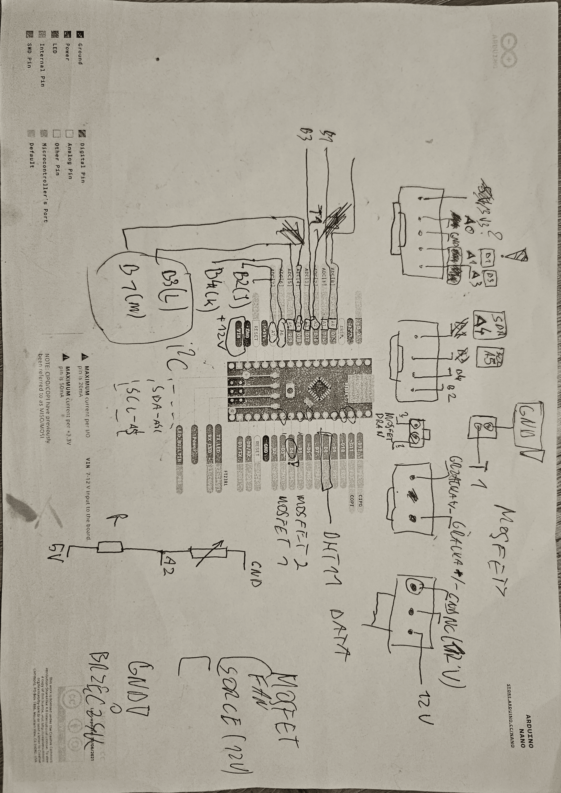
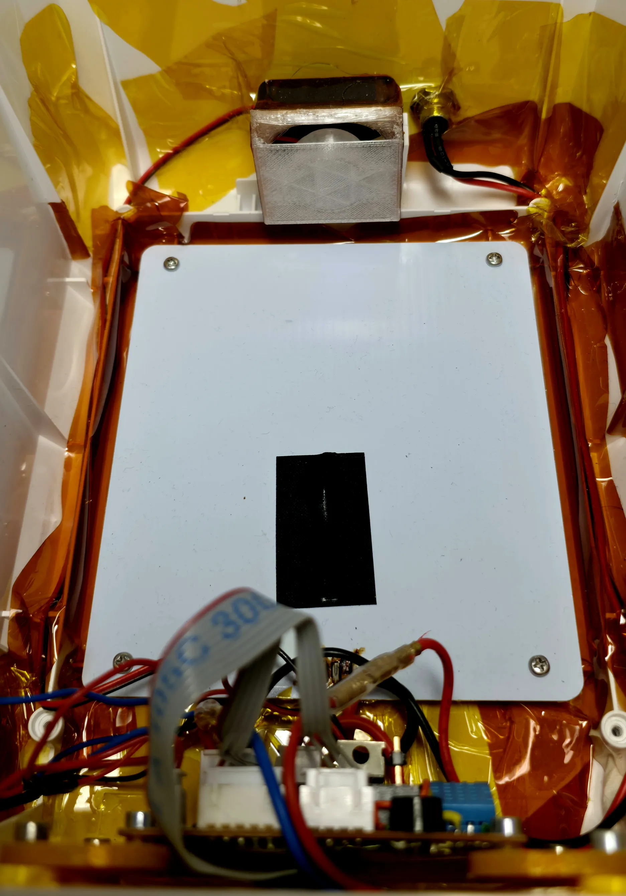
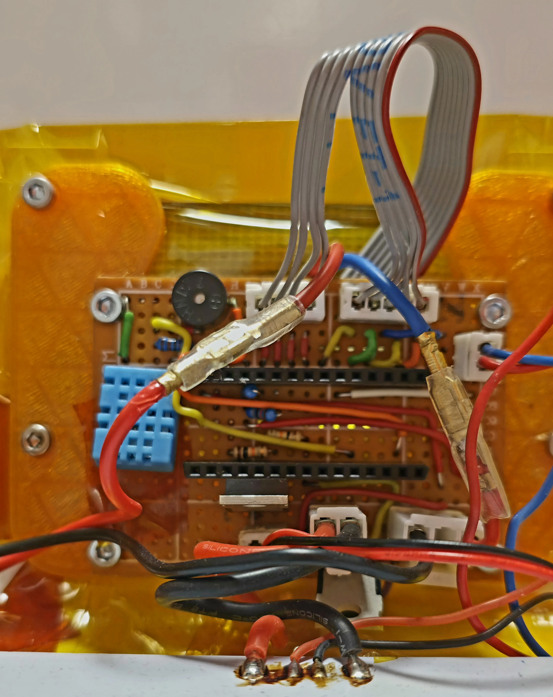

# Drybox Controller

An Arduino Nano-based filament drybox controller with PID temperature control, OLED display, and preset drying profiles for various 3D printer filaments.



## Build Photos

| Chamber: heater plate and fan | Controller board |
|---|---|
|  |  |

## Features

- **PID Temperature Control**: Precise heating with custom PID implementation
- **Multiple Profiles**: Pre-configured settings for PLA, PETG, ABS, TPU, and Nylon
- **Real-time Monitoring**: DHT11 sensor for ambient temperature and humidity
- **OLED Display**: 128x64 I2C display showing status and controls
- **Safety Features**: Overheat protection and sensor fault detection
- **Audio Feedback**: Buzzer for user interaction confirmation

## Hardware Requirements

- Arduino Nano (ATmega328P)
- DHT11 Temperature/Humidity Sensor
- SSD1306 OLED Display (128x64, I2C)
- 100kΩ NTC Thermistor with series resistor (firmware calibrated to 12kΩ, see `include/thermistor.h`)
- 4 Push Buttons in a 2x2 grid: UP / BACK on top, DOWN / OK below
- 2x N-channel MOSFETs for heater and fan control
- Active buzzer
- 12V Heating element
- 12V Circulation fan

## Pin Configuration

| Pin  | Function       | Notes                              |
|------|----------------|------------------------------------|
| D3   | Heater PWM     | Timer2 PWM, MOSFET gate            |
| D5   | Fan Control    | Digital, MOSFET gate               |
| D8   | DHT11 Data     | Temperature/Humidity sensor        |
| A0   | Buzzer         | Active buzzer                      |
| A1   | Button UP      | INPUT_PULLUP                       |
| A2   | Thermistor     | Series resistor to 5V, NTC to GND  |
| A3   | Button DOWN    | INPUT_PULLUP (bottom-left)         |
| A4   | OLED SDA       | Display data                       |
| A5   | OLED SCL       | Display clock                      |
| A6   | Button OK      | External 10k pull-up (bottom-right)|
| A7   | Button BACK    | External 10k pull-up required      |

## Getting Started

### Prerequisites

- [PlatformIO](https://platformio.org/) installed (VS Code extension or CLI)
- Arduino Nano connected via USB

### Building and Uploading

```bash
# Clone the repository
git clone git@github.com:Granulka/drybox.git
cd drybox

# Build the firmware
pio run

# Upload to Arduino Nano
pio run --target upload

# Monitor serial output (optional)
pio device monitor

# Run automated tests (recommended before upload)
pio test -e native
```

Upload speed is set to 57600 (old Nano bootloader). For a Nano with the new
bootloader set `upload_speed = 115200` in `platformio.ini`.

### Bench test without the PCB

The `nano_debug` environment adds serial telemetry and injected buttons/temperature
so the whole state machine can be exercised on a bare Nano:

```bash
pio run -e nano_debug -t upload --upload-port /dev/ttyUSBx
python3 tools/bench_test.py     # edit PORT at the top of the script
pio run -e nanoatmega328 -t upload --upload-port /dev/ttyUSBx   # back to production
```

### Testing Before Upload

The project includes comprehensive automated tests for critical hardware control functions:

```bash
# Run all 37 tests
pio test -e native

# Tests verify:
# - Thermistor temperature calculations
# - PID controller behavior
# - Safety features (overheat, fault detection)
```

All tests should pass before uploading firmware to your Arduino.

### Using the Controller

1. **Power On**: System starts in IDLE mode showing current temperatures
2. **Press OK**: Enter menu to select drying profile
3. **Navigate**: Use UP/DOWN buttons to select profile
4. **Start Cycle**: Press OK to begin drying
5. **Monitor**: Display shows temperature, PWM%, and remaining time
6. **Abort**: Press BACK during cycle to stop early
7. **Complete**: System beeps when cycle finishes

## Drying Profiles

| Filament | Temperature | Duration |
|----------|-------------|----------|
| PLA      | 45°C        | 4 hours  |
| PETG     | 65°C        | 6 hours  |
| ABS      | 65°C        | 6 hours  |
| TPU      | 50°C        | 6 hours  |
| Nylon    | 75°C        | 12 hours |

## Safety Features

- Maximum temperature cutoff at 90°C
- Thermistor fault detection
- Automatic heater shutdown on error
- Fault state with warning beep
- Heater-response check: full power for 10 min without a 2°C rise → fault
- Watchdog: if the firmware stalls for 4 s, heater OFF, fan ON, repeating beep until power cycle
- I2C bus timeout (a stuck OLED bus cannot freeze the control loop)
- Display check at power-on: without an answering OLED the controller only beeps and does not run
- Fan runs for the whole cycle, 3 min after it, and while the heater is above 40°C (off again below 35°C)

## Documentation

For detailed technical documentation, see [docs/TECHNICAL.md](docs/TECHNICAL.md)

## Automated Testing

This project includes 37 automated tests covering critical hardware control:

- **Thermistor Tests**: ADC conversion, temperature calculations
- **PID Tests**: Control algorithm, output limits, anti-windup
- **Safety Tests**: Overtemperature detection, fault handling

Run tests with: `pio test -e native`

## Project Structure

```
Drybox/
├── platformio.ini          # PlatformIO configuration
├── src/
│   └── main.cpp           # Main firmware
├── include/               # Testable library headers
├── test/                  # Automated tests (37 tests)
├── tools/                 # Bench-test script for the debug build
├── legacy/                # Earlier single-file iterations (not built)
├── docs/
│   ├── TECHNICAL.md       # Detailed technical documentation
│   ├── hardware-sketch.png  # Hand-drawn wiring sketch
│   └── photos/            # Photos of the build
└── README.md              # This file
```

## Contributing

Feel free to submit issues and pull requests for improvements!

## License

Open source - modify and distribute freely

